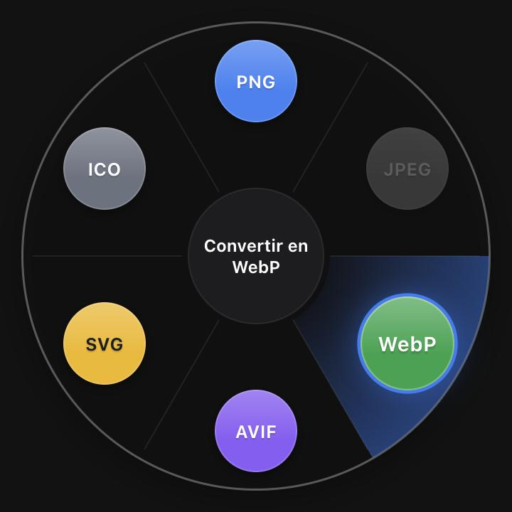
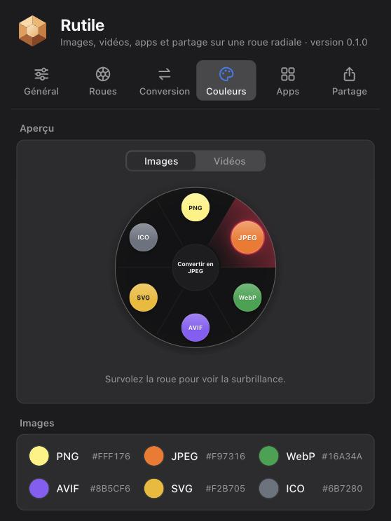

# Rutile

**Convertir, lancer et partager depuis une roue, sans quitter ce qu'on fait.**

[](https://github.com/ThomasDlv0/rutile-app/releases/latest)
[](https://github.com/ThomasDlv0/rutile-app/actions/workflows/ci.yml)


Rutile tourne en arrière-plan. Un raccourci clavier, ou un fichier secoué pendant qu'on le
glisse, ouvre une roue sous le curseur : chaque part est une action. On y convertit une image
ou une vidéo dans un autre format, on lance une app, on envoie un fichier par AirDrop ou dans
Google Drive. Pour qui jongle souvent avec des fichiers (graphistes, développeurs, créateurs
de contenu) et en a assez d'ouvrir un logiciel ou un site pour passer un PNG en WebP.

| Roue des images | Roue des vidéos |
|---|---|
|  |  |
| **Roue de partage** | **Réglages des couleurs** |
|  |  |

<!-- Geste complet (glisser, secouer, convertir) : enregistrer docs/screenshots/geste.gif puis
     retirer ce commentaire autour de la ligne suivante.

-->

### Fonctionnalités

- **Quatre roues**, qu'on fait tourner d'un clic au centre : images, vidéos, apps et partage.
  Chacune s'active ou se désactive, dans l'ordre de son choix.
- **Conversion directe** : un fichier lâché sur une part est converti aussitôt, à côté de
  l'original, sans jamais rien écraser (`photo-1.png` si `photo.png` existe).
- **Roue intelligente** : une image ouvre la roue des images, une vidéo celle des vidéos. Un
  fichier maintenu au centre passe à la roue de partage, puis revient au convertisseur.
- **Fichiers sélectionnés** : si le Finder ou l'Explorateur est au premier plan, la roue
  reprend sa sélection ; sinon, un clic sur une part ouvre le sélecteur de fichiers.
- **Roue des apps** : une app par part ; un fichier glissé dessus s'ouvre avec elle.
- **Roue de partage** : AirDrop, Messages, Mail, Notes… (macOS), dossiers synchronisés (Google
  Drive, iCloud Drive, Dropbox, OneDrive) et messageries comme Signal (fichier copié, puis
  collé dans la conversation).
- **Couleurs** : une couleur par format et pour la part survolée, avec aperçu en direct ; le
  texte passe en clair ou en foncé pour rester lisible.
- **FFmpeg embarqué** : la conversion vidéo fonctionne sans rien installer d'autre.

### Formats pris en charge

| | Entrée | Sortie |
|---|---|---|
| Images | PNG, JPEG, WebP, AVIF, GIF (première image), BMP, TIFF, ICO, SVG | PNG, JPEG, WebP, AVIF, SVG, ICO |
| Vidéos | tout ce que lit FFmpeg (MP4, MOV, WebM, MKV, AVI, WMV, FLV, MPEG-TS…), GIF animé | MP4, WebM, MOV, MKV, GIF animé, MP3 (son seul) |

- Le format d'un fichier est reconnu d'après son contenu, pas son extension.
- **Seule la sortie SVG est vectorisée** : l'image est retracée en formes de couleur unie,
  idéal pour un logo, approximatif pour une photo. Les autres formats restent en pixels.
- JPEG : la transparence devient un fond blanc. ICO : tailles 16, 32, 48 et 256 px.
- Qualité par défaut : JPEG 90, WebP 85, AVIF 70 (réglable). Les métadonnées (EXIF, profil
  ICC) ne sont pas conservées ; seule l'orientation EXIF est appliquée.
- Vidéo : MP4 et MOV en H.264 + AAC, WebM en VP9 + Opus, MKV sans réencodage (instantané),
  GIF à 12 images/s et 640 px de large au plus, MP3 refusé pour une vidéo muette.

## Installation

Télécharger le fichier de son système dans la
[**dernière release**](https://github.com/ThomasDlv0/rutile-app/releases/latest). Rutile n'est
signé ni par Apple ni par Microsoft : chaque système affiche donc un avertissement au premier
lancement, expliqué ci-dessous.

### macOS 11 ou plus récent (Apple Silicon et Intel)

1. Ouvrir `Rutile_x.y.z_macos_universal.dmg` et glisser Rutile dans Applications.
2. Premier lancement : si macOS dit que l'app est endommagée ou ne peut pas être vérifiée,
   retirer la quarantaine, puis relancer :

   ```bash
   xattr -dr com.apple.quarantine /Applications/Rutile.app
   ```

   Autre possibilité : Réglages Système → Confidentialité et sécurité → « Ouvrir quand même ».
3. Rutile n'a pas d'icône dans le Dock : elle apparaît dans la barre des menus.
4. Autorisations : Rutile ne demande **pas** l'accessibilité (le secouage relève l'état de la
   souris sans intercepter d'événement). macOS demande seulement, à la première utilisation,
   l'**Automatisation → Finder** (lire les fichiers sélectionnés) et les **notifications**.
   Un refus se corrige dans Réglages Système → Confidentialité et sécurité → Automatisation.

### Windows 10 et 11 (x64)

1. Lancer `Rutile_x.y.z_windows_x64_setup.exe` : installation pour l'utilisateur, sans droits
   d'administrateur. WebView2 est installé s'il manque. Le `.msi` installe pour toute la
   machine (droits d'administrateur).
2. SmartScreen : « Informations complémentaires », puis « Exécuter quand même ».
3. Les éditions N de Windows (sans Media Foundation) sont prises en charge : la vidéo passe
   uniquement par le FFmpeg embarqué.

### Linux x64

- **AppImage** (recommandé, fonctionne partout, Bazzite compris) :

  ```bash
  chmod +x Rutile_x.y.z_linux_x86_64.AppImage
  ./Rutile_x.y.z_linux_x86_64.AppImage
  ```

  Si elle refuse de démarrer faute de FUSE : `./Rutile_*.AppImage --appimage-extract-and-run`.
- **Debian, Ubuntu** : `sudo apt install ./Rutile_x.y.z_linux_amd64.deb`.
- **Fedora, openSUSE** : `sudo dnf install ./Rutile_x.y.z_linux_x86_64.rpm`.
- **Bazzite et distributions immuables** (Fedora Atomic, Silverblue…) : on n'y installe pas de
  paquets, prendre l'AppImage. Gear Lever (déjà présent sur Bazzite) l'intègre au menu des
  applications.
- **Secouage sous Wayland** : aucune app ne peut suivre la souris ailleurs que sur ses
  fenêtres, Rutile lit donc les souris avec evdev, ce qui demande le groupe `input` (qui donne
  aussi accès au clavier : le secouage reste désactivé par défaut). Sur Bazzite, le groupe doit
  d'abord être copié dans `/etc/group` :

  ```bash
  grep -E '^input:' /usr/lib/group | sudo tee -a /etc/group
  sudo usermod -aG input "$USER"
  ```

  Puis fermer et rouvrir la session, et activer le secouage dans les réglages.
- **Raccourci sous GNOME Wayland** : les apps ne peuvent pas y écouter le clavier. Paramètres →
  Clavier → Raccourcis personnalisés → « + », avec la commande
  `/chemin/vers/Rutile_x.y.z_linux_x86_64.AppImage --open` (ou `rutile --open` avec le `.deb`
  ou le `.rpm`), sur la combinaison de son choix.
- L'icône de la barre système demande, sous GNOME, l'extension « AppIndicator ».

### Prise en main

- **Ouvrir la roue** : `⌘⇧Espace` sur macOS, `Ctrl+Maj+Espace` sous Windows et Linux X11 (se
  change dans Réglages → Général). Un nouvel appui la referme. Aussi depuis l'icône de la barre
  système, ou avec `rutile --open [fichiers…]`.
- **Secouer** : pendant qu'on glisse un fichier, quelques allers-retours rapides ouvrent la
  roue sous le curseur ; lâcher le fichier sur une part.
- **Centre de la roue** : un clic passe à la roue suivante. Pendant un glisser, rester au
  centre (1 s par défaut, réglable) passe au partage ; y revenir repasse au convertisseur ;
  relâcher au centre annule.
- **Fermer** : `Échap` ou clic à l'extérieur. À la fin d'une conversion, une notification
  propose d'afficher le fichier.
- **Réglages** : icône de la barre système → « Réglages… », en six onglets (Général, Roues,
  Conversion, Couleurs, Apps, Partage). Ils sont enregistrés dans `settings.json`, dans le
  dossier de configuration (`~/Library/Application Support/fr.rutile.desktop`,
  `%APPDATA%\fr.rutile.desktop` ou `~/.config/fr.rutile.desktop`).

## Mode développement

### Prérequis

| Système | À installer |
|---|---|
| Tous | [Node.js 22](https://nodejs.org) et [Rust stable](https://rustup.rs) |
| macOS | outils en ligne de commande de Xcode : `xcode-select --install` |
| Windows | [Build Tools de Visual Studio](https://visualstudio.microsoft.com/visual-cpp-build-tools/) (« Développement Desktop en C++ »), WebView2 (déjà présent sur Windows 10 et 11), [NASM](https://nasm.us) |
| Linux (Debian, Ubuntu) | `sudo apt install libwebkit2gtk-4.1-dev libayatana-appindicator3-dev librsvg2-dev libxdo-dev libssl-dev patchelf nasm` |

NASM sert au décodeur AVIF sur les processeurs x86_64 (Windows, Linux, Mac Intel). Le détail
des dépendances de Tauri : [tauri.app/start/prerequisites](https://tauri.app/start/prerequisites/).

### Lancer l'app

```bash
git clone https://github.com/ThomasDlv0/rutile-app.git
cd rutile-app
npm install
npm run tauri dev
```

En développement, la vidéo utilise le FFmpeg du système (`brew install ffmpeg`, `winget
install Gyan.FFmpeg`, `sudo apt install ffmpeg`), ou celui que télécharge
`bash scripts/fetch-ffmpeg.sh` (variable `RUTILE_FFMPEG` pour en désigner un autre).

Aperçu de l'interface dans un navigateur, sans Tauri : `npm run dev`, puis
`http://localhost:1420/?file=photo.png` (ou `?file=clip.mov`) pour la roue et
`http://localhost:1420/?view=settings` pour les réglages.

### Tests, auto-test et build local

```bash
npm run lint             # vérification des types de l'interface
npm test                 # tests de l'interface (Vitest)
cargo clippy --workspace --all-targets -- -D warnings
cargo test --workspace   # conversion d'images et de vidéos, secouage, réglages…
cargo run -p rutile -- --self-test   # chaque conversion de la roue, de bout en bout
npm run build:release    # FFmpeg embarqué + paquets du système courant, dans target/release/bundle
```

`rutile --self-test` crée des images et une courte vidéo d'exemple, les convertit vers chaque
format, relit chaque fichier produit et quitte avec le code 0 (tout passe) ou 1. Sous Windows,
l'app n'a pas de console : `& "$env:LOCALAPPDATA\Rutile\rutile.exe" --self-test | Out-Host`.

Le code système (`crates/platform`) n'a ni Tauri ni code C : il se vérifie pour les autres
systèmes depuis n'importe quelle machine.

```bash
rustup target add x86_64-pc-windows-msvc x86_64-unknown-linux-gnu
cargo clippy -p rutile-platform --target x86_64-pc-windows-msvc
cargo clippy -p rutile-platform --target x86_64-unknown-linux-gnu
```

### Organisation

```
src/                    interface React + TypeScript
  wheel/                roue : rendu, géométrie, survol, dépôt, couleurs
  settings/             fenêtre de réglages
crates/converter/       conversion d'images (Rust) et de vidéos (FFmpeg), auto-test
crates/shake_detector/  reconnaissance du secouage à partir des mouvements de la souris
crates/platform/        code propre à chaque système : souris, sélection, session, apps, partage
src-tauri/              app Tauri : roue, raccourci, barre système, réglages, notifications…
scripts/fetch-ffmpeg.sh FFmpeg statique embarqué, par système (empreintes vérifiées)
.github/workflows/      ci.yml à chaque push, release.yml sur un tag v*
```

### Publier une nouvelle version

1. Mettre le même numéro dans `package.json`, `src-tauri/Cargo.toml` et
   `src-tauri/tauri.conf.json`, et écrire `docs/release-notes/vX.Y.Z.md`.
2. Commiter, puis pousser un tag :

   ```bash
   git tag vX.Y.Z
   git push origin vX.Y.Z
   ```

Le workflow `release.yml` vérifie que les versions concordent, construit les paquets des
trois systèmes avec tauri-action, teste l'app installée sur chacun (`--self-test`, et
lancement de 10 s sous Windows et Linux), puis publie la release seulement si tout passe.

## Limites connues par système

| | macOS | Windows | Linux X11 | Linux Wayland (GNOME) |
|---|---|---|---|---|
| Raccourci global | oui | oui | oui | non : `rutile --open` lié à un raccourci du système |
| Sélection du gestionnaire de fichiers | Finder | Explorateur (onglets et bureau compris) | non : script Nautilus | non : script Nautilus |
| Secouage | oui, pendant un glisser de fichiers | oui | oui | avec le groupe `input` |
| Roue sous le curseur | oui | oui | oui | non : centre de l'écran |
| Roue des apps | `.app`, avec icône | `.exe` ou `.lnk`, sans icône (nom seul) | `.desktop`, avec icône | idem X11 |
| Partage : services (AirDrop…) | oui | non | non | non |
| Partage : dossiers synchronisés | oui | oui | oui | oui |
| Partage : messageries (presse-papiers) | oui | oui | avec `xclip` | avec `wl-copy` |

- **Linux, sélection des fichiers** : aucune interface commune ne donne la sélection des
  gestionnaires de fichiers. Avec Nautilus, un script dans `~/.local/share/nautilus/scripts/`
  (clic droit → Scripts) joue le même rôle :

  ```sh
  #!/bin/sh
  exec /chemin/vers/Rutile.AppImage --open "$@"
  ```

- **Linux, affichage** : sous Wayland, la roue passe par XWayland (`GDK_BACKEND=x11`), seul
  moyen sous GNOME de la garder au premier plan. Le rendu DMA-BUF de WebKitGTK, qui peut
  laisser une fenêtre blanche ou vide (cartes NVIDIA surtout), est désactivé
  (`WEBKIT_DISABLE_DMABUF_RENDERER=1`). La transparence de la roue demande un compositeur
  (GNOME, KDE) ; elle n'a pas encore été vérifiée sur une vraie machine Linux.
- **Windows** : le suivi de la souris ne voit pas les fenêtres d'une app lancée en
  administrateur ; les icônes des apps ne sont pas encore extraites.
- **Paquets non signés** : macOS (Gatekeeper) et Windows (SmartScreen) préviennent au premier
  lancement. Les signer demanderait un compte développeur Apple et un certificat de signature
  de code Windows.
- **Taille** : FFmpeg embarqué pèse de 75 Mo (Windows, Linux) à 118 Mo (macOS universel) une
  fois installé.

## Licences

FFmpeg est embarqué sous le nom `rutile-ffmpeg`, sous licence GPL v3 : voir
[THIRD_PARTY_LICENSES.md](THIRD_PARTY_LICENSES.md).
