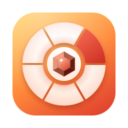
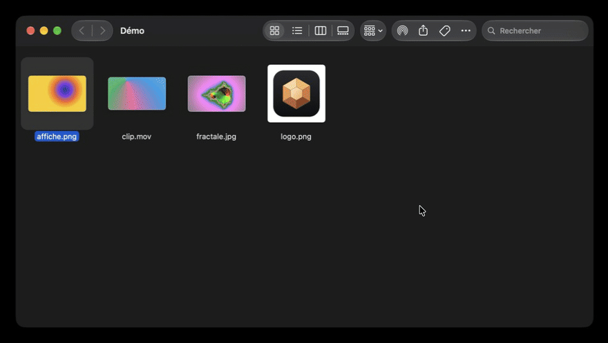
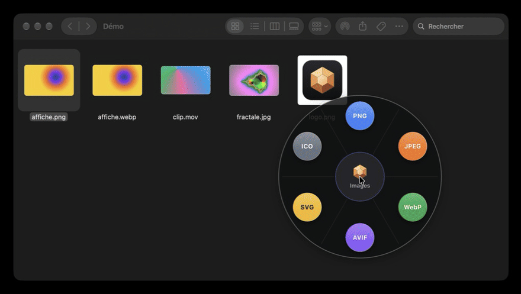
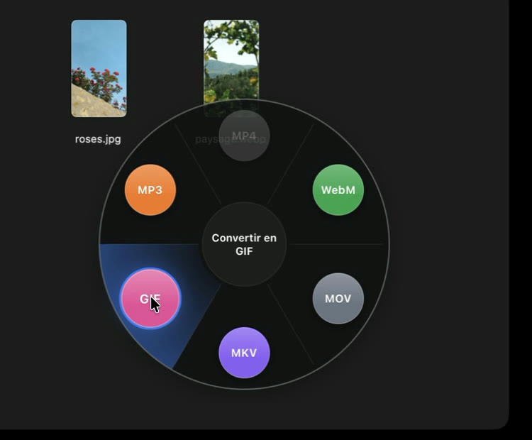
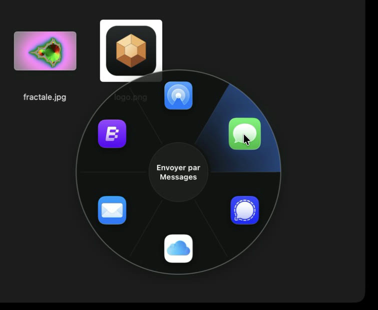
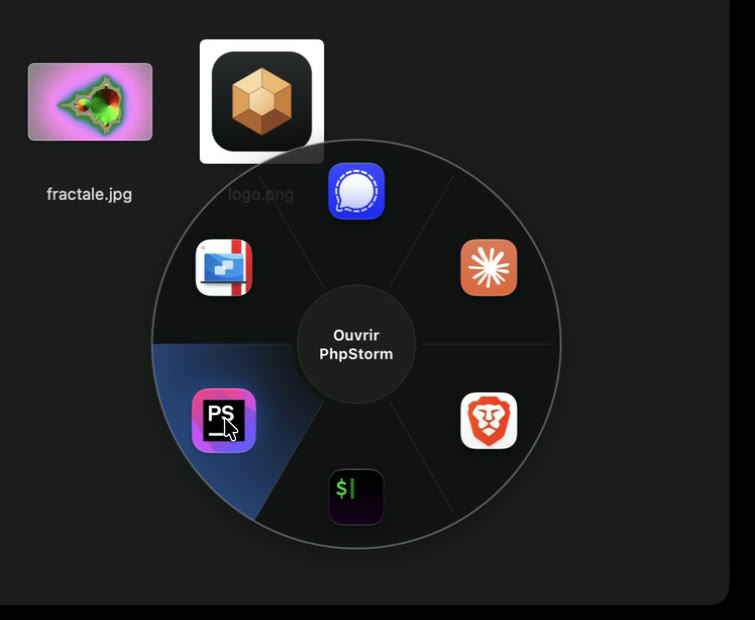
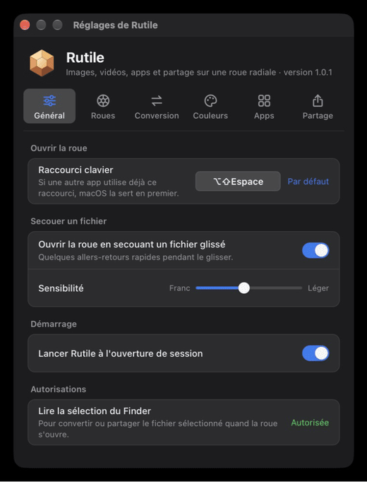

<p align="center">
  
</p>

<h1 align="center">Rutile</h1>

<p align="center">
  <strong>Une roue sous le curseur pour convertir, ouvrir et partager vos fichiers.</strong><br>
  Un raccourci ou un fichier secoué, une part de la roue, et c'est fait.
</p>

<p align="center">
  <a href="#installation"><strong>Installation</strong></a> ·
  <a href="#fonctionnalités"><strong>Fonctionnalités</strong></a> ·
  <a href="#formats-pris-en-charge"><strong>Formats</strong></a> ·
  <a href="#questions-fréquentes"><strong>FAQ</strong></a> ·
  <a href="#développement"><strong>Développement</strong></a>
</p>

<p align="center">
  <a href="https://github.com/ThomasDlv0/rutile-app/releases/latest"></a>
  <a href="https://github.com/ThomasDlv0/rutile-app/actions/workflows/ci.yml"></a>
  
</p>

<p align="center">
  <a href="https://github.com/ThomasDlv0/rutile-app/releases/latest"></a>
  <a href="https://github.com/ThomasDlv0/rutile-app/releases/latest"></a>
  <a href="https://github.com/ThomasDlv0/rutile-app/releases/latest"></a>
</p>

<p align="center">
  
</p>

Rutile tourne en arrière-plan et ouvre, sous le curseur, une roue dont chaque part est une
action : passer une image en WebP, une vidéo en MP4, ouvrir une app, envoyer un fichier par
AirDrop. Pour qui jongle avec des fichiers toute la journée et n'a plus envie d'ouvrir un
logiciel ou un site juste pour passer un PNG en JPEG.

Gratuit, sans compte, sans publicité et sans suivi. Les conversions se font **sur votre
machine** : aucun fichier n'est envoyé sur internet pour être converti. FFmpeg est inclus,
il n'y a rien d'autre à installer.

## Fonctionnalités

### Convertir sans ouvrir de logiciel

Sélectionnez un fichier dans le Finder ou l'Explorateur et ouvrez la roue
(<kbd>⌘</kbd> <kbd>⇧</kbd> <kbd>Espace</kbd> sur macOS, <kbd>Ctrl</kbd> <kbd>Maj</kbd>
<kbd>Espace</kbd> sous Windows et Linux) : un clic sur un format, et le fichier converti
apparaît **à côté de l'original**, qui n'est jamais modifié ni écrasé (`photo-1.png` si
`photo.png` existe déjà).

Pendant un glisser, **secouez le fichier** de quelques allers-retours : la roue s'ouvre avec sa
part du haut sous le curseur, il suffit de le lâcher sur un format. Les formats impossibles
pour ce fichier (celui qu'il a déjà, par exemple) sont grisés.

### Cinq roues, un clic au centre

<p align="center">
  
</p>

**Images**, **vidéos**, **apps**, **partage** et **actions** : un clic au centre passe à la
roue suivante. Chacune s'active ou se désactive, dans l'ordre de votre choix.

La roue s'adapte au fichier : une image ouvre la roue des images, une vidéo celle des vidéos,
et tout autre fichier (PDF, ZIP, document…) la roue Actions, réduite à ce qui lui convient. La
roue ouverte d'abord se règle pour chaque type de fichier. Pendant un glisser, **restez au
centre** : un anneau se remplit (1 s par défaut) et la roue passe au partage ; y revenir
repasse au convertisseur.

### La roue Actions

**Restez une seconde sur une part** : ses options s'ouvrent dans une nouvelle roue. Le centre
ramène à la roue d'avant, comme <kbd>Échap</kbd>.

| Part | Un clic | En restant dessus |
|---|---|---|
| **Capture** | capture une zone, copiée dans le presse-papiers et enregistrée dans Images/Rutile | zone, fenêtre, écran, dans 3 secondes |
| **Texte** | tracez une zone : son texte est copié, sans rien envoyer sur internet | |
| **Couleur** | copie la couleur prise à l'écran | en HEX, RGB ou HSL |
| **Fichiers** | | ZIP, extraire un ZIP, images en PDF, fusion de PDF, renommage en lot (numéros, date, minuscules, sans accents) |
| **Image** | | moitié de la taille, 1920 pixels, alléger, retirer les métadonnées |
| **Vidéo** | | alléger, tenir dans 10 ou 25 Mo, GIF, MP3, retirer le son |
| **Fenêtres** | | moitié gauche, droite, haute ou basse, agrandir, centrer |
| **Apps** | passe à la roue des apps | |
| **Mes roues** | | vos propres actions : un Raccourci macOS, une commande ou un site |

Les parts se réordonnent et se masquent dans les réglages. Un fichier déposé sur une action la
lance sur ce fichier, et les actions se lancent aussi sur la sélection du Finder ou de
l'Explorateur. Rien n'est écrasé : le résultat s'écrit à côté de l'original. Une bulle à côté
du curseur dit ce qui s'est passé, même si les notifications sont coupées.

### La roue Actions d'un fichier

Avec un fichier secoué, glissé ou sélectionné, la roue Actions ne montre que ce qui a un sens
pour lui, directement sur la roue :

| Fichiers | Actions proposées |
|---|---|
| **Images** | alléger, moitié, 1920 pixels, copier le texte de l'image, copier l'image, en PDF, retirer les métadonnées |
| **Vidéos** | alléger, 10 ou 25 Mo, GIF, MP3, retirer le son |
| **PDF** | fusionner (à partir de deux), copier le texte |
| **Archives ZIP** | extraire |
| **Tous** | ZIP, renommer, copier le chemin, et vos roues faites pour ces extensions |

Pour chaque type, l'onglet Actions des réglages choisit la roue qui s'ouvre d'abord (le
convertisseur pour les images et les vidéos, la roue Actions pour le reste), ainsi que l'ordre
des actions et celles qui s'affichent.

### Vidéos : changer de format, faire un GIF, garder le son

<p align="center">
  
</p>

MP4, WebM, MOV, MKV, **GIF animé** et **MP3** (le son seul), grâce au FFmpeg embarqué. Une
notification annonce la fin de la conversion et propose d'afficher le fichier.

### Partager en un geste

<p align="center">
  
</p>

- **« Partager… »** ouvre le menu de partage de macOS, celui du bouton Partager du Finder :
  choisissez l'app (Messages, AirDrop, Mail, WhatsApp, Telegram…), puis le destinataire.
- **AirDrop, Messages, Mail** et tous les services de partage de macOS, en accès direct.
- **Dossiers synchronisés** : Google Drive, iCloud Drive, Dropbox, OneDrive… Le fichier y est
  copié ; un clic sans fichier ouvre le dossier.
- **Messageries** comme Signal, qui n'acceptent pas de fichier venant d'une autre app : le
  fichier est copié, l'app s'ouvre, il n'y a plus qu'à le coller dans la conversation.

### Vos apps sous la main

<p align="center">
  
</p>

Jusqu'à dix apps, une par part, avec leurs **pastilles de notifications** comme dans le Dock
(macOS), y compris celles que le Dock garde pour une app fermée, comme Messages, si vous
donnez à Rutile l'autorisation Accessibilité (Réglages → Apps). Un fichier lâché sur une app
s'ouvre avec elle. Une part peut aussi ouvrir un dossier ou un site web.

### À vos couleurs



Les réglages tiennent en sept onglets :

- **Général** : raccourci, secouage et sa sensibilité, lancement à l'ouverture de session.
- **Roues** : ordre des roues (en les glissant) et activation, temps de maintien, retour sur
  la dernière roue utilisée.
- **Conversion** : qualité JPEG, WebP et AVIF.
- **Couleurs** : cliquez sur une part de l'aperçu pour changer sa couleur, sur le centre pour
  celle de la surbrillance. Liquid Glass et contour de la roue (clair, noir ou aucun). Le
  texte passe en clair ou en foncé pour rester lisible.
- **Actions** : ordre et affichage des parts, roue ouverte d'abord et actions proposées pour
  chaque type de fichier, vos roues personnalisées (limitées ou non à certaines extensions),
  et ce qui suit une capture.
- **Apps** et **Partage** : de six à dix parts chacune, à réordonner en les glissant.

<br clear="right">

## Formats pris en charge

| | Entrée | Sortie |
|---|---|---|
| **Images** | PNG, JPEG, WebP, AVIF, GIF (première image), BMP, TIFF, ICO, SVG | PNG, JPEG, WebP, AVIF, SVG, ICO |
| **Vidéos** | tout ce que lit FFmpeg (MP4, MOV, WebM, MKV, AVI, WMV, FLV, MPEG-TS…), GIF animé | MP4, WebM, MOV, MKV, GIF animé, MP3 (son seul) |

<details>
<summary><strong>Détails des conversions</strong></summary>
<br>

- Le format d'un fichier est reconnu d'après son contenu, pas son extension.
- **Seule la sortie SVG est vectorisée** : l'image est retracée en formes de couleur unie,
  idéal pour un logo, approximatif pour une photo. Les autres formats restent en pixels.
- JPEG : la transparence devient un fond blanc. ICO : tailles 16, 32, 48 et 256 px.
- Qualité par défaut : JPEG 90, WebP 85, AVIF 70 (réglable). Les métadonnées (EXIF, profil
  ICC) ne sont pas conservées ; seule l'orientation EXIF est appliquée.
- Vidéo : MP4 et MOV en H.264 + AAC, WebM en VP9 + Opus, MKV sans réencodage (instantané),
  GIF à 12 images/s et 640 px de large au plus, MP3 refusé pour une vidéo muette.

</details>

## Installation

Téléchargez le fichier de votre système dans la
[**dernière version**](https://github.com/ThomasDlv0/rutile-app/releases/latest). Rutile
n'est signé ni par Apple ni par Microsoft : chaque système affiche donc un avertissement au
premier lancement, expliqué ci-dessous.

| Système | Fichier |
|---|---|
| macOS 12 ou plus récent (Apple Silicon et Intel) | `Rutile_x.y.z_macos_universal.dmg` |
| Windows 10 et 11 (x64) | `Rutile_x.y.z_windows_x64_setup.exe` ou `.msi` |
| Linux x64 | `Rutile_x.y.z_linux_x86_64.AppImage`, `.deb` ou `.rpm` |

<details>
<summary><strong>macOS</strong></summary>
<br>

1. Ouvrez le `.dmg` et glissez Rutile dans Applications.
2. Au premier lancement, si macOS dit que l'app est endommagée ou ne peut pas être vérifiée,
   retirez la quarantaine puis relancez :

   ```bash
   xattr -dr com.apple.quarantine /Applications/Rutile.app
   ```

   Autre possibilité : Réglages Système → Confidentialité et sécurité → « Ouvrir quand même ».
3. Rutile n'a pas d'icône dans le Dock : elle apparaît dans la barre des menus.
4. Autorisations : macOS demande, à la première utilisation, l'**Automatisation → Finder**
   (lire les fichiers sélectionnés) et les **notifications**. Un refus se corrige dans
   Réglages Système → Confidentialité et sécurité → Automatisation. Le secouage n'a pas
   besoin de l'accessibilité (il lit l'état de la souris sans intercepter d'événement) ;
   elle ne sert qu'aux pastilles des apps fermées, et Rutile ne la demande que si vous
   cliquez sur « Autoriser… » dans Réglages → Apps.

</details>

<details>
<summary><strong>Windows</strong></summary>
<br>

1. Lancez le `_setup.exe` : installation pour votre seul compte, sans droits
   d'administrateur. WebView2 est installé s'il manque. Le `.msi` installe pour toute la
   machine (droits d'administrateur).
2. SmartScreen : « Informations complémentaires », puis « Exécuter quand même ».
3. Les éditions N de Windows (sans Media Foundation) sont prises en charge : la vidéo passe
   uniquement par le FFmpeg embarqué.

</details>

<details>
<summary><strong>Linux (et Bazzite)</strong></summary>
<br>

- **AppImage** (recommandée, fonctionne partout, Bazzite compris) :

  ```bash
  chmod +x Rutile_x.y.z_linux_x86_64.AppImage
  ./Rutile_x.y.z_linux_x86_64.AppImage
  ```

  Si elle refuse de démarrer faute de FUSE : `./Rutile_*.AppImage --appimage-extract-and-run`.
- **Debian, Ubuntu** : `sudo apt install ./Rutile_x.y.z_linux_amd64.deb`.
- **Fedora, openSUSE** : `sudo dnf install ./Rutile_x.y.z_linux_x86_64.rpm`.
- **Bazzite et distributions immuables** (Fedora Atomic, Silverblue…) : on n'y installe pas
  de paquets, prenez l'AppImage. Gear Lever (déjà présent sur Bazzite) l'intègre au menu des
  applications.
- **Secouage sous Wayland** : aucune app ne peut suivre la souris hors de ses fenêtres,
  Rutile lit donc les souris avec evdev, ce qui demande le groupe `input` (qui donne aussi
  accès au clavier : le secouage reste désactivé par défaut). Sur Bazzite, le groupe doit
  d'abord être copié dans `/etc/group` :

  ```bash
  grep -E '^input:' /usr/lib/group | sudo tee -a /etc/group
  sudo usermod -aG input "$USER"
  ```

  Fermez puis rouvrez la session, et activez le secouage dans les réglages.
- **Raccourci sous GNOME Wayland** : les apps ne peuvent pas y écouter le clavier.
  Paramètres → Clavier → Raccourcis personnalisés → « + », avec la commande
  `/chemin/vers/Rutile_x.y.z_linux_x86_64.AppImage --open` (ou `rutile --open` avec le
  `.deb` ou le `.rpm`), sur la combinaison de votre choix.
- L'icône de la barre système demande, sous GNOME, l'extension « AppIndicator ».

</details>

### Prise en main

| | |
|---|---|
| **Ouvrir la roue** | <kbd>⌘</kbd> <kbd>⇧</kbd> <kbd>Espace</kbd> (macOS) ou <kbd>Ctrl</kbd> <kbd>Maj</kbd> <kbd>Espace</kbd> (Windows, Linux X11), modifiable dans Réglages → Général ; ou l'icône de la barre système, ou `rutile --open [fichiers…]` |
| **Secouer** | pendant un glisser, quelques allers-retours rapides ouvrent la roue, sa part du haut sous le curseur |
| **Changer de roue** | un clic au centre ou <kbd>↑</kbd> <kbd>↓</kbd> ; pendant un glisser, rester au centre bascule entre conversion et partage |
| **Options d'une action** | rester sur la part ; le centre, <kbd>Échap</kbd> ou <kbd>⌫</kbd> reviennent en arrière |
| **Au clavier** | <kbd>←</kbd> <kbd>→</kbd> passent d'une part à l'autre, <kbd>Entrée</kbd> lance la part choisie ; <kbd>1</kbd> à <kbd>9</kbd> (<kbd>0</kbd> pour la dixième) la lancent directement, en partant du haut dans le sens horaire |
| **Annuler** | relâcher au centre, <kbd>Échap</kbd> ou un clic à l'extérieur |
| **Réglages** | icône de la barre système → « Réglages… » |

Les réglages sont enregistrés dans `settings.json`, dans
`~/Library/Application Support/fr.rutile.desktop`, `%APPDATA%\fr.rutile.desktop` ou
`~/.config/fr.rutile.desktop`.

## Questions fréquentes

<details>
<summary><strong>Le Liquid Glass est-il le vrai ?</strong></summary>
<br>

Sur macOS 26 et plus récent, oui : le disque et le centre sont de vraies vues
`NSGlassEffectView`, le verre du système. Sur les versions plus anciennes, sous Windows et sous
Linux, ce verre n'existe pas : la roue en dessine une imitation, sans le flou ni la réfraction
de ce qu'il y a derrière. Il se désactive dans Réglages → Couleurs.

</details>

<details>
<summary><strong>Quelles autorisations pour la roue Actions (macOS) ?</strong></summary>
<br>

- **Capture et texte** : Enregistrement de l'écran, y compris pour une zone choisie à la main.
- **Couleur** : la loupe du système, sans autorisation.
- **Fenêtres** : Accessibilité.

Rutile n'étant pas signé par Apple, macOS peut oublier ces autorisations après une mise à
jour : retirez Rutile de la liste avec « − », puis autorisez-le de nouveau.

</details>

<details>
<summary><strong>Que faut-il sous Linux pour la roue Actions ?</strong></summary>
<br>

- **Capture et pipette** : le portail du bureau (`xdg-desktop-portal`), présent sous GNOME et KDE.
- **Texte** : Tesseract, à installer (`tesseract-ocr`, avec sa langue française).
- **Fenêtres** : sous X11 seulement. Wayland ne laisse pas une app déplacer les fenêtres : la
  part n'apparaît pas.

</details>

<details>
<summary><strong>Mes fichiers partent-ils sur internet ?</strong></summary>
<br>

Non. Les images sont converties par le code de Rutile et les vidéos par le FFmpeg embarqué,
sur votre machine. Seule la roue de partage envoie un fichier, quand vous le lui demandez
(AirDrop, Messages, dossier synchronisé…).

</details>

<details>
<summary><strong>Comment Rutile se met-il à jour ?</strong></summary>
<br>

À partir de la 1.2.0, Rutile regarde la dernière version publiée ici peu après son lancement,
puis toutes les six heures. S'il en trouve une plus récente, il propose de l'installer
(« Mettre à jour » ou « Plus tard ») : il la télécharge, vérifie sa signature, l'installe et
redémarre. Rien n'est installé sans votre accord.

- On peut aussi chercher soi-même : icône de la barre système → « Rechercher les mises à
  jour… », ou Réglages → Général → Mises à jour, où la recherche automatique se désactive.
- Sous Linux, une AppImage se remplace d'elle-même ; un `.deb` ou un `.rpm` demande le mot de
  passe administrateur.
- La 1.1.0 et les versions d'avant n'ont pas ce système : installez une fois la nouvelle
  version à la main.

</details>

<details>
<summary><strong>Et si on m'envoie un fichier piégé ?</strong></summary>
<br>

Rutile limite ce qu'un fichier peut lui faire faire :

- **SVG** : une image désignée par un chemin ou une adresse (`<image href="…">`) n'est jamais
  lue. Seules les images intégrées au fichier sont rendues : un SVG ne peut pas glisser une
  autre de vos images dans le résultat.
- **Vidéos** : le FFmpeg embarqué (9.0.2, à jour des failles connues de la 6.1) ne lit que des
  fichiers locaux, et seulement les conteneurs vidéo que la roue accepte (MP4, MOV, MKV, WebM,
  AVI, WMV, FLV, MPEG-TS, MPEG, Ogg, GIF). Un fichier d'un autre format déguisé en vidéo est
  refusé.

Une faille ? Signalez-la dans une [issue](https://github.com/ThomasDlv0/rutile-app/issues).

</details>

<details>
<summary><strong>L'original est-il modifié ?</strong></summary>
<br>

Jamais. Le fichier converti est écrit à côté, sous un nouveau nom s'il le faut
(`photo-1.webp`, `photo-2.webp`…).

</details>

<details>
<summary><strong>Les images converties sont-elles vectorisées ?</strong></summary>
<br>

Seulement vers SVG : l'image est retracée en formes de couleur unie, ce qui donne un vrai
fichier vectoriel, très bon pour un logo ou une icône, approximatif pour une photo. Vers PNG,
JPEG, WebP, AVIF et ICO, l'image reste en pixels.

</details>

<details>
<summary><strong>Pourquoi Signal reçoit-il le fichier par copier-coller ?</strong></summary>
<br>

Sur ordinateur, Signal n'accepte pas de fichier envoyé par une autre app : il n'a pas
d'extension de partage, ni sur macOS, ni sous Windows, ni sous Linux. Rutile copie donc le
fichier et ouvre Signal : choisissez la conversation, puis collez (<kbd>⌘</kbd> <kbd>V</kbd>
ou <kbd>Ctrl</kbd> <kbd>V</kbd>). Sur macOS, « Partager… » propose aussi toutes les apps qui
acceptent les fichiers, avec le choix du destinataire.

</details>

<details>
<summary><strong>Le raccourci clavier ne fait rien</strong></summary>
<br>

Une autre app l'utilise sûrement déjà : le système la sert en premier. Choisissez une autre
combinaison dans Réglages → Général. Sous GNOME Wayland, passez par un raccourci du système
(voir l'installation sous Linux).

</details>

<details>
<summary><strong>Une pastille du Dock n'apparaît pas sur la roue (macOS)</strong></summary>
<br>

Sans autorisation, Rutile ne voit que les pastilles des apps ouvertes. Messages ou Mail
gardent la leur dans le Dock une fois fermés : pour la voir aussi sur la roue, cliquez sur
« Autoriser… » dans Réglages → Apps, puis activez Rutile dans Réglages Système →
Confidentialité et sécurité → Accessibilité. Rutile n'étant pas signé par Apple, macOS peut
ne plus le reconnaître après une mise à jour : retirez-le de la liste avec « − », puis
autorisez-le de nouveau.

</details>

<details>
<summary><strong>macOS dit que Rutile est endommagée</strong></summary>
<br>

C'est l'avertissement des apps non signées par Apple, pas un vrai problème du fichier.
Retirez la quarantaine : `xattr -dr com.apple.quarantine /Applications/Rutile.app`.

</details>

<details>
<summary><strong>Sous Linux, la roue est blanche ou vide</strong></summary>
<br>

Rutile désactive déjà le rendu DMA-BUF de WebKitGTK (`WEBKIT_DISABLE_DMABUF_RENDERER=1`), en
cause le plus souvent, surtout avec une carte NVIDIA. La roue suit aussi la mise à l'échelle
du texte du système (Cinnamon, GNOME) sans déborder de sa fenêtre. La transparence de la roue demande
aussi un compositeur (GNOME, KDE). Si le problème persiste, ouvrez une
[issue](https://github.com/ThomasDlv0/rutile-app/issues) avec votre distribution et votre
carte graphique.

</details>

<details>
<summary><strong>Pourquoi l'app pèse-t-elle si lourd ?</strong></summary>
<br>

FFmpeg est embarqué pour que la vidéo marche sans rien installer : 91 Mo sous Linux, 105 Mo
sous Windows et 161 Mo sur macOS, qui contient les versions Apple Silicon et Intel.

</details>

<details>
<summary><strong>Limites connues par système</strong></summary>
<br>

| | macOS | Windows | Linux X11 | Linux Wayland (GNOME) |
|---|---|---|---|---|
| Raccourci global | oui | oui | oui | non : `rutile --open` lié à un raccourci du système |
| Sélection du gestionnaire de fichiers | Finder | Explorateur (onglets et bureau compris) | non : script Nautilus | non : script Nautilus |
| Secouage | oui, pendant un glisser de fichiers | oui | oui | avec le groupe `input` |
| Roue sous le curseur | oui | oui | oui | non : centre de l'écran |
| Roue des apps | `.app`, avec icône | `.exe` ou `.lnk`, sans icône (nom seul) | `.desktop`, avec icône | idem X11 |
| Pastilles de notifications | apps ouvertes ; apps fermées avec l'accessibilité | non | non | non |
| Partage : menu du système, services (AirDrop…) | oui | non | non | non |
| Partage : dossiers synchronisés | oui | oui | oui | oui |
| Partage : messageries (presse-papiers) | oui | oui | avec `xclip` | avec `wl-copy` |

- **Linux, sélection des fichiers** : aucune interface commune ne donne la sélection des
  gestionnaires de fichiers. Avec Nautilus, un script dans `~/.local/share/nautilus/scripts/`
  (clic droit → Scripts) joue le même rôle :

  ```sh
  #!/bin/sh
  exec /chemin/vers/Rutile.AppImage --open "$@"
  ```

- **Linux, affichage** : sous Wayland, la roue passe par XWayland (`GDK_BACKEND=x11`), seul
  moyen sous GNOME de la garder au premier plan. Sa transparence n'a pas encore été vérifiée
  sur une vraie machine Linux.
- **Windows** : le suivi de la souris ne voit pas les fenêtres d'une app lancée en
  administrateur ; les icônes des apps ne sont pas encore extraites.
- **Paquets non signés** : macOS (Gatekeeper) et Windows (SmartScreen) préviennent au premier
  lancement. Les signer demanderait un compte développeur Apple et un certificat de signature
  de code Windows.

</details>

## Développement

<details>
<summary><strong>Prérequis</strong></summary>
<br>

| Système | À installer |
|---|---|
| Tous | [Node.js 22](https://nodejs.org) et [Rust stable](https://rustup.rs) |
| macOS | outils en ligne de commande de Xcode : `xcode-select --install` |
| Windows | [Build Tools de Visual Studio](https://visualstudio.microsoft.com/visual-cpp-build-tools/) (« Développement Desktop en C++ »), WebView2 (déjà présent sur Windows 10 et 11), [NASM](https://nasm.us) |
| Linux (Debian, Ubuntu) | `sudo apt install libwebkit2gtk-4.1-dev libayatana-appindicator3-dev librsvg2-dev libxdo-dev libssl-dev patchelf nasm` |

NASM sert au décodeur AVIF sur les processeurs x86_64 (Windows, Linux, Mac Intel). Le détail
des dépendances de Tauri : [tauri.app/start/prerequisites](https://tauri.app/start/prerequisites/).

</details>

<details>
<summary><strong>Lancer l'app</strong></summary>
<br>

```bash
git clone https://github.com/ThomasDlv0/rutile-app.git
cd rutile-app
npm install
npm run tauri dev
```

En développement, la vidéo utilise le FFmpeg du système (`brew install ffmpeg`, `winget
install Gyan.FFmpeg`, `sudo apt install ffmpeg`), ou celui que télécharge
`bash scripts/fetch-ffmpeg.sh` (variable `RUTILE_FFMPEG` pour en désigner un autre).

Aperçu de l'interface dans un navigateur, sans Tauri : `npm run dev`, puis
`http://localhost:1420/?file=photo.png` (ou `?file=clip.mov`) pour la roue et
`http://localhost:1420/?view=settings` pour les réglages.

</details>

<details>
<summary><strong>Tests, auto-test et build local</strong></summary>
<br>

```bash
npm run lint             # vérification des types de l'interface
npm test                 # tests de l'interface (Vitest)
cargo clippy --workspace --all-targets -- -D warnings
cargo test --workspace   # conversion d'images et de vidéos, secouage, réglages…
cargo run -p rutile -- --self-test   # chaque conversion de la roue, de bout en bout
npm run build:release    # FFmpeg embarqué + paquets du système courant, dans target/release/bundle
```

`rutile --self-test` crée des images et une courte vidéo d'exemple, les convertit vers chaque
format, relit chaque fichier produit et quitte avec le code 0 (tout passe) ou 1. Sous Windows,
l'app n'a pas de console : `& "$env:LOCALAPPDATA\Rutile\rutile.exe" --self-test | Out-Host`.

Le code système (`crates/platform`) n'a ni Tauri ni code C : il se vérifie pour les autres
systèmes depuis n'importe quelle machine.

```bash
rustup target add x86_64-pc-windows-msvc x86_64-unknown-linux-gnu
cargo clippy -p rutile-platform --target x86_64-pc-windows-msvc
cargo clippy -p rutile-platform --target x86_64-unknown-linux-gnu
```

</details>

<details>
<summary><strong>Organisation du code</strong></summary>
<br>

```
src/                    interface React + TypeScript
  wheel/                roue : rendu, géométrie, survol, dépôt, couleurs
  settings/             fenêtre de réglages
crates/converter/       conversion d'images (Rust) et de vidéos (FFmpeg), auto-test
crates/shake_detector/  reconnaissance du secouage à partir des mouvements de la souris
crates/platform/        code propre à chaque système : souris, sélection, session, apps, partage
src-tauri/              app Tauri : roue, raccourci, barre système, réglages, notifications…
scripts/fetch-ffmpeg.sh FFmpeg statique embarqué, par système (empreintes vérifiées)
.github/workflows/      ci.yml à chaque push, release.yml sur un tag v*
```

</details>

<details>
<summary><strong>Publier une nouvelle version</strong></summary>
<br>

1. Mettre le même numéro dans `package.json`, `src-tauri/Cargo.toml` et
   `src-tauri/tauri.conf.json`, et écrire `docs/release-notes/vX.Y.Z.md`.
2. Commiter, puis pousser un tag :

   ```bash
   git tag vX.Y.Z
   git push origin vX.Y.Z
   ```

Le workflow `release.yml` vérifie que les versions concordent, construit les paquets des
trois systèmes avec tauri-action, teste l'app installée sur chacun (`--self-test`, et
lancement de 10 s sous Windows et Linux), puis publie la version seulement si tout passe.

</details>

## Sous le capot

Rutile est une app [Tauri 2](https://tauri.app) : le cœur en Rust, l'interface en React et
TypeScript. Les conversions reposent sur des bibliothèques open source :

- [`image`](https://github.com/image-rs/image) pour PNG, JPEG, GIF, BMP, TIFF et ICO ;
- [`webp`](https://github.com/jaredforth/webp) (libwebp) pour WebP ;
- [`ravif`](https://github.com/kornelski/cavif-rs) (rav1e) pour écrire l'AVIF,
  [`avif-decode`](https://github.com/kornelski/avif-decode) (rav1d) pour le lire ;
- [`vtracer`](https://github.com/visioncortex/vtracer) pour vectoriser en SVG,
  [`resvg`](https://github.com/linebender/resvg) pour lire le SVG ;
- [FFmpeg](https://ffmpeg.org) 9.0.2 pour la vidéo, limité aux fichiers locaux et aux
  conteneurs vidéo que la roue accepte ;
- [`lopdf`](https://github.com/J-F-Liu/lopdf) pour les PDF,
  [`zip`](https://github.com/zip-rs/zip2) pour les archives ;
- Vision (macOS), `Windows.Media.Ocr` et Tesseract (Linux) pour lire le texte.

## Licences

FFmpeg est embarqué sous le nom `rutile-ffmpeg`, sous licence GPL v3 : voir
[THIRD_PARTY_LICENSES.md](THIRD_PARTY_LICENSES.md).
